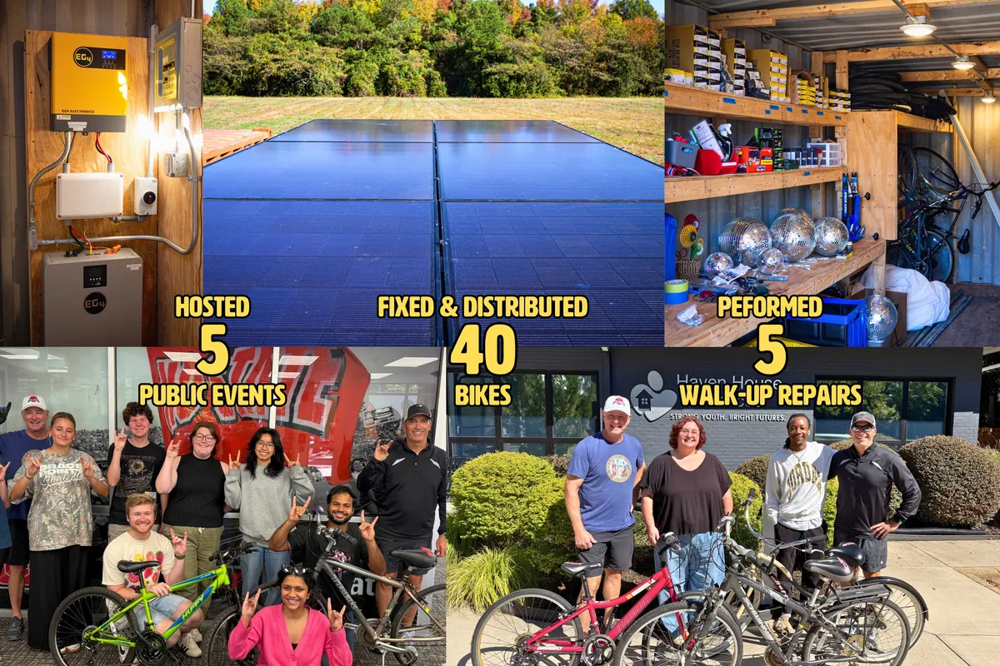
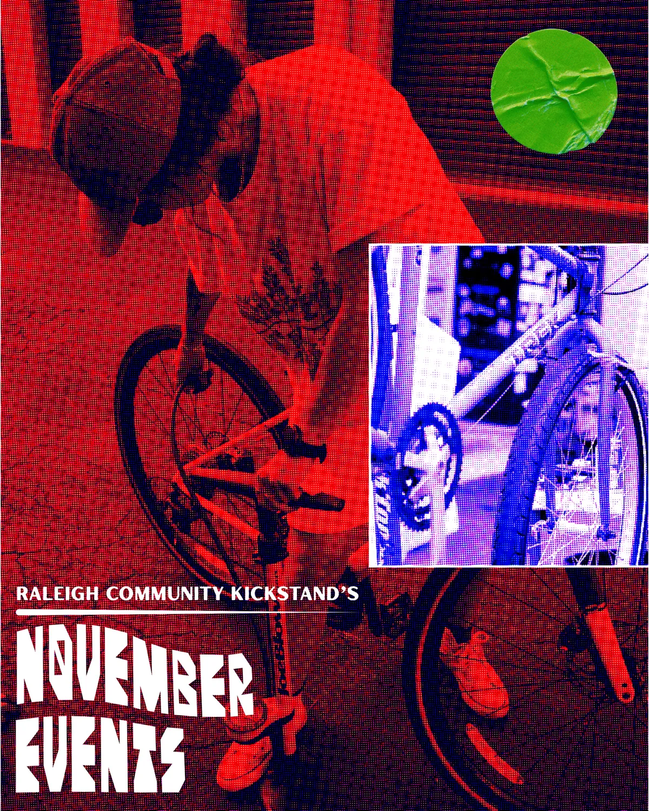
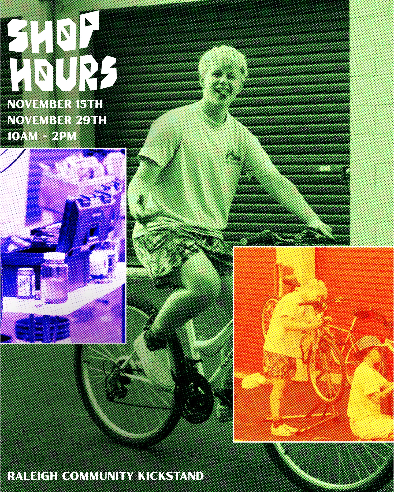
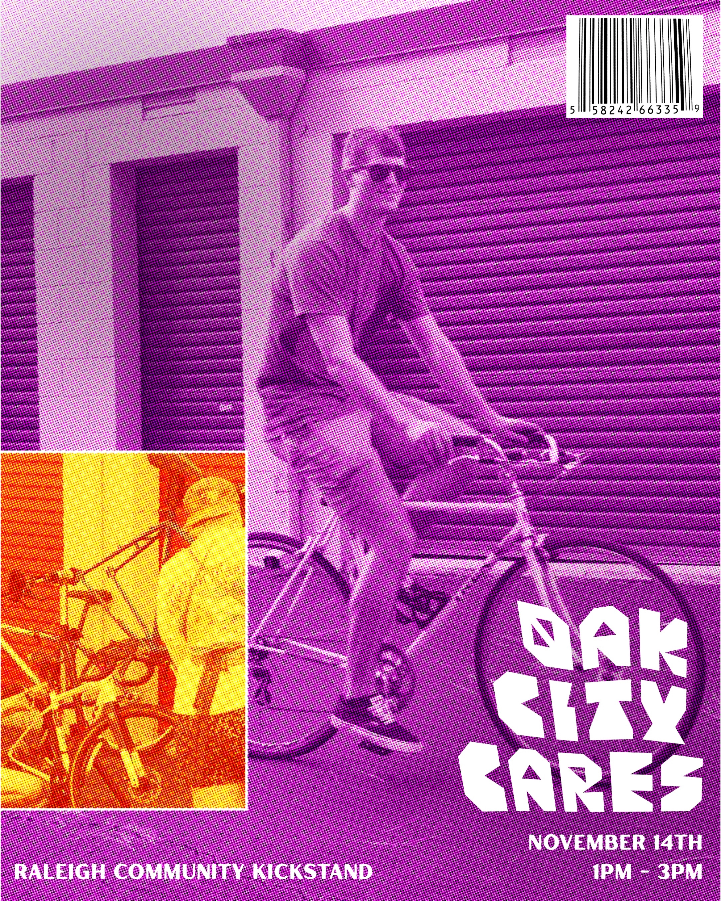
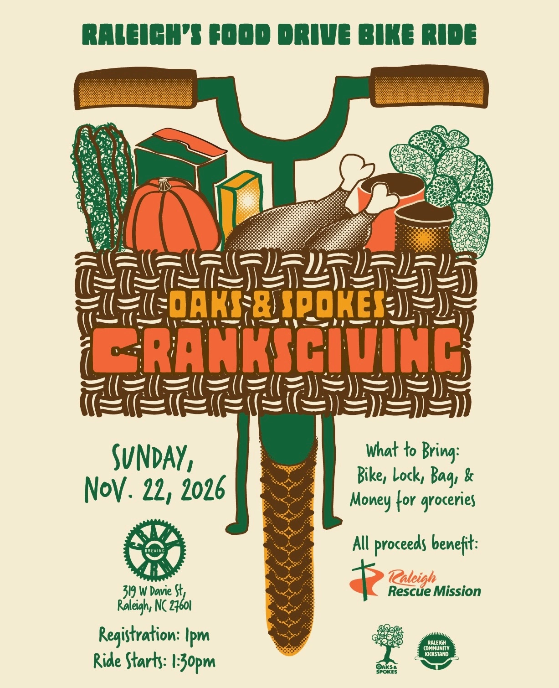

# November 2026 Newsletter

## Monthly Dispatch



Photos by Jared Harber & Ron Luciani

In October, we hosted 5 free public events, including our usual pop-up repair events, community shop hours, and helping present maintenance workshops at Dix Chapel with Oaks & Spokes. All told, we tuned up 45 bikes last month. We distributed 40 bikes through Feed the Pack Pantry, Haven House, Raleigh Rescue Mission, Cornerstone Center, Durham Community Food Pantry, Healing Transitions, and direct mutual aid efforts.

After successful completion of our fundraising campaign for the storage containers at Dix Park, we were able to hit the ground running by starting to outfit them to serve as a new community bike shop. NCSolarNow finished the solar panel install. As we head into the colder, more dormant months, we will keep chipping away at making these little boxes our new home. Please reach out if you want to help with these efforts or any other behind the scenes work.

Huge thanks to everyone who gives their time to repair bikes and keep this collective running smoothly to ensure more people in our community have safe, reliable, self-sufficient transportation. See you in November!

## November Events


<!-- ```carousel




``` -->

Flyers by Kylie Robinsun

**Pop-Up Free Bike Repair \- volunteers needed\!**  
When: Saturday, November 14 \| 1-3p  
Where: Oak City Cares \- 1430 S Wilmington Street  
We repair and occasionally distribute bikes on a first-come, first-served basis the 2nd Saturday of each month at Oak City Cares, a multiservice center for folks experiencing housing insecurity. We will have some tools and stands, but we often have more volunteers than stations, so feel free to bring your own. Please fill out the sheet below letting us know you are coming and how you’d like to help with the event.  
[https\://docs.google.com/spreadsheets/d/1VJGkxpowGLi9LNfFjneI8mNoEKFTLBa6J27K8PHTpyE/edit?gid=302512647\#gid=302512647](https://docs.google.com/spreadsheets/d/1VJGkxpowGLi9LNfFjneI8mNoEKFTLBa6J27K8PHTpyE/edit?gid=302512647#gid=302512647)

**Community Shop Hours \- everyone welcome\!**  
When: Sundays, November 15 & 29, 10a-2p  
Where: Public Storage \- 4615 Beryl Rd  
Our open shop hours at our storage space. Folks can come use our tools to learn about bike repair, work on their bike, and/or work on bikes for distribution. It’s a fun time working on bikes in good company. Contact [volunteer@raleighcommunitykickstand.org](mailto:volunteer@raleighcommunitykickstand.org) in advance for the gate access info.

**Cranksgiving \- join us\!**  
When: Sunday, November 22 \| 1-5p  
Where: Crank Arm Brewing \- 319 W Davie St  
Cranksgiving is a fun choose-your-own-adventure event put on by Oaks & Spokes all about riding a bike and giving back to our communities in need during the holiday season. You receive a list of essential food items to purchase, and you ride out to nearby groceries to collect goods and drop them back off. You receive points for weight, distance, and key items with some bonus point challenges. It’s a great time. We often have some good Kickstand representation at this event and put together a team.
